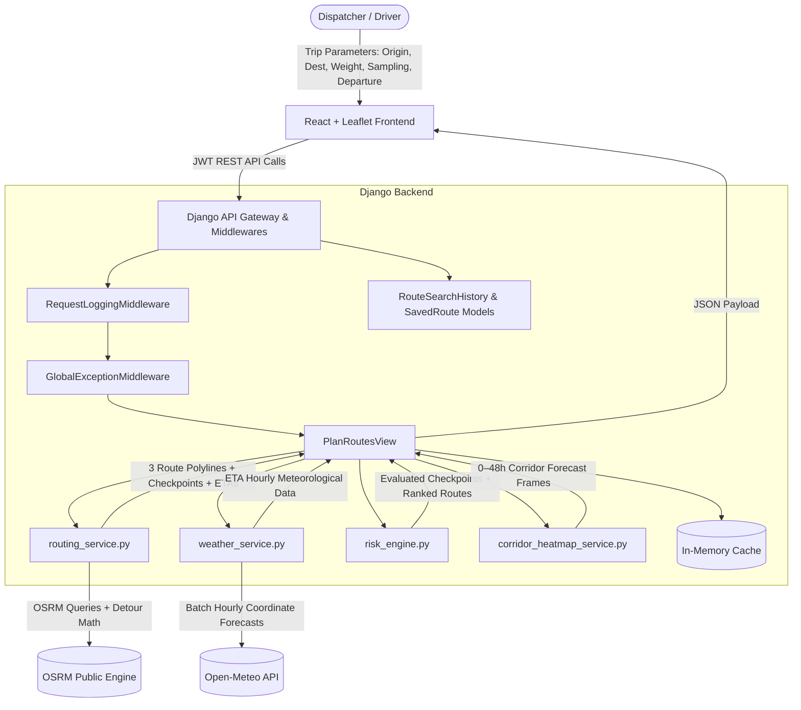

# Spotter — System Design & Architecture Specification

## 1. Overview & Problem Definition
Spotter is an intelligent routing and weather hazard evaluation platform engineered specifically for commercial freight operations. 

Standard consumer navigation platforms (such as Google Maps or basic OSRM implementations) optimize solely for shortest physical distance or fastest free-flow transit time. They do not account for meteorological hazards or commercial vehicle dynamics. 

In commercial logistics:
- **Light/Empty Trailers (< 30,000 lbs):** A standard 53-foot dry van has an elevated center of pressure. In sustained crosswinds or gusts exceeding 40 mph, aerodynamic lateral forces create acute rollover hazards.
- **Heavy Cargo (> 40,000 lbs up to 80,000 lbs GVW):** Heavy trucks have greater resistance to wind overturn, but exhibit substantially longer braking distances and heightened jackknife risks on wet, hydroplaning, or icy surfaces.

Spotter addresses this by calculating three viable driving corridors, interpolating discrete checkpoints with exact arrival timestamps, correlating hourly meteorological forecasts at the predicted time of arrival, and evaluating safety using a deterministic risk engine.

---

## 2. System Architecture

---

## 3. Core Subsystems & Algorithmic Pipeline

### 3.1 Routing & Corridor Generation (`routing_service.py`)
- **Primary Route Acquisition:** Queries OSRM with `geometries=geojson`, `overview=full`, `steps=true`, and `alternatives=true`.
- **Perpendicular Midpoint Detour Fallback:** When OSRM returns fewer than 3 distinct highway paths, the system computes the geographical midpoint between origin $(o_{lat}, o_{lon})$ and destination $(d_{lat}, d_{lon})$.
  - Normalizes the perpendicular vector:
    $$\Delta lat = d_{lat} - o_{lat}, \quad \Delta lon = d_{lon} - o_{lon}$$
    $$\text{norm} = \sqrt{(\Delta lat)^2 + (\Delta lon)^2}$$
    $$\vec{perp} = \left(-\frac{\Delta lon}{\text{norm}}, \frac{\Delta lat}{\text{norm}}\right)$$
  - Applies a scaled angular offset to generate North/South or East/West corridor waypoints:
    $$wp = mid \pm \vec{perp} \times \text{offset}$$
  - Queries OSRM via these detour waypoints and validates uniqueness against existing route distances to guarantee three distinct driving options.

### 3.2 Checkpoint Slicing & Arrival Time Calculation
- Iterates through the polyline vertices and computes cumulative mileage using the Haversine formula.
- Samples points at user-specified intervals (10, 25, or 50 miles) plus the terminal destination.
- For each checkpoint $i$, the elapsed driving duration is computed proportionally from cumulative distance:
  $$\text{fraction}_i = \frac{\text{target\_miles}_i}{\text{total\_route\_miles}}$$
  $$\text{elapsed\_seconds}_i = \text{total\_duration\_seconds} \times \text{fraction}_i$$
  $$\text{ETA}_i = \text{departure\_time} + \text{elapsed\_seconds}_i$$

### 3.3 Meteorological Ingestion & Temporal Alignment (`weather_service.py`)
- Deduplicates all checkpoint coordinates across candidate routes to minimize remote network requests.
- Queries Open-Meteo's hourly forecast API in batches of 20–30 coordinates for:
  - Sustained wind speed (10m above ground, mph)
  - Peak wind gusts (mph)
  - Precipitation rate (in/hr)
  - Snowfall rate (in/hr)
  - Temperature (°F)
- Matches each checkpoint's calculated $\text{ETA}_i$ to the corresponding hourly forecast window. Conditions are evaluated based on when the truck will physically be present at that coordinate.

### 3.4 Risk Engine & Load Escalation Rules (`risk_engine.py`)

#### Base Meteorological Thresholds
| Risk Level | Sustained Wind (mph) | Rainfall Rate (in/hr) | Snowfall Rate (in/hr) | Score Value |
| :--- | :--- | :--- | :--- | :--- |
| **Low** | $< 25$ | $< 0.10$ | $< 0.5$ | 1.0 |
| **Moderate** | $25\text{–}34$ | $0.10\text{–}0.25$ | $0.5\text{–}1.0$ | 2.0 |
| **High** | $35\text{–}44$ | $0.25\text{–}0.50$ | $1.0\text{–}2.0$ | 3.0 |
| **Severe** | $45\text{–}54$ | $0.50\text{–}1.00$ | $2.0\text{–}3.0$ | 4.0 |
| **No Travel** | $\ge 55$ | $> 1.00$ | $> 3.0$ | 5.0 |

#### Commercial Load Escalations
1. **Absolute Cutoff:** Any sustained wind or gust $\ge 55\text{ mph}$ enforces an automatic **No Travel** order regardless of cargo weight.
2. **Heavy Vehicle Braking Hazard:** Sustained winds between $45\text{–}54\text{ mph}$ with a cargo weight exceeding $30,000\text{ lbs}$ escalate to **No Travel**.
3. **Rollover Hazard:** Sustained winds between $35\text{–}44\text{ mph}$ with a cargo weight exceeding $40,000\text{ lbs}$ escalate from High Risk to **Severe**.

#### Deterministic Route Ranking Hierarchy
Candidate corridors are ranked using a 4-tier decision algorithm:
1. **Tier 1:** Route with the fewest combined **Severe and No-Travel miles**.
2. **Tier 2:** Route with the fewest **High-Risk miles**.
3. **Tier 3:** Route with the lowest **composite average risk score**.
4. **Tier 4:** Route with the shortest **total travel time**.

The highest-ranking route is designated with `is_recommended: true`.

---

## 4. Frontend Cartography & State Architecture

### 4.1 State Machine (`App.jsx`)
- `viewMode`: Manages application state between `'planner'` (full-screen input interface) and `'results'` (split-screen evaluation dashboard).
- `activeRouteId`: Controls active route polyline rendering and camera bounds.
- `activeStopIndex` & `isAnimating`: Coordinates the stop-by-stop route animation. An interval steps through checkpoints, synchronizing the floating HUD and timeline scrubber.

### 4.2 Vector Layering (`MapView.jsx`)
- **Base Map:** OpenStreetMap Street View tiles (`https://tile.openstreetmap.org/{z}/{x}/{y}.png`) with an optional dark canvas toggle.
- **Route Polylines:** Segmented into discrete sub-paths colored by risk level (`#10b981` for Low through `#7f1d1d` for No Travel). Inactive routes render as dashed comparison polylines.
- **Checkpoint Markers:** Rendered as Leaflet `CircleMarker` instances using native vector styling to ensure markers remain precisely anchored to road coordinates across zoom levels.
- **Vehicle Animation Marker:** Rendered via Leaflet `divIcon` with an inline SVG truck and risk-colored safety halo, accompanied by a real-time HUD tooltip showing milestone, wind speed, ETA, and hazard rating.

---

## 5. Security, Middleware & Data Persistence

- **Authentication:** JWT (JSON Web Tokens) with automated token rotation and refresh via `djangorestframework-simplejwt`.
- **Request Tracing:** `RequestLoggingMiddleware` assigns a unique UUID `X-Request-ID` to every HTTP transaction and logs millisecond latency.
- **Global Error Handling:** `GlobalExceptionMiddleware` intercepts unhandled server exceptions and returns uniform JSON error payloads.
- **Caching:** Django in-memory cache stores geocoding results and weather frames with a 24-hour TTL to eliminate redundant external calls.
- **Persistence:** SQLite database models (`RouteSearchHistory` and `SavedRoute`) track dispatched queries and user-bookmarked routes.
