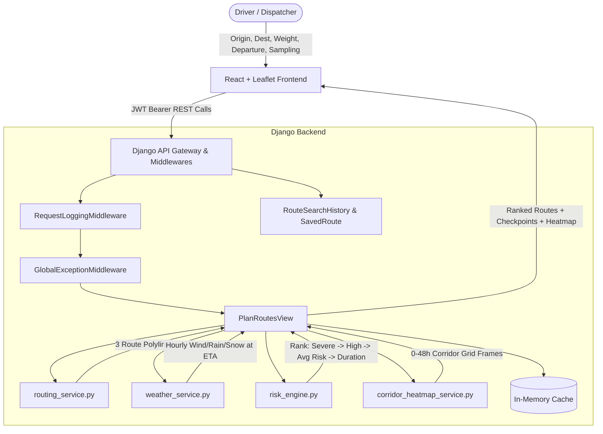

# Spotter — Weather-Aware Truck Routing & Fleet Cockpit

A full-stack freight navigation platform built with **Django REST Framework** and **React + Leaflet** that assists truck drivers and fleet dispatchers in comparing route candidates using weather forecasts along the route corridor, cargo weight, and travel time.

---

## 🌟 Key Features

1. **Three Candidate Routes**:
   - Requests routes from the public OSRM service, tries waypoint detours when needed, and can synthesize variants of an existing route. Three displayed candidates are not always three independently validated road routes.
2. **Dynamic Checkpoint Weather Sampling (10 / 25 / 50 Miles)**:
   - Samples weather every **10, 25, or 50 miles** along each route using the truck's exact estimated arrival time (**ETA**) at each checkpoint ($departure\_time + cumulative\_duration$).
   - Integrates with **Open-Meteo Free Forecast API** (no API key required) for hourly wind speed (mph), precipitation rate (in/hr), snowfall rate (in/hr), and temperature.
3. **Strict Weather & Load Risk Engine**:
   - Evaluates risk thresholds:
     - **Wind (mph)**: Low (`<25`), Moderate (`25–34`), High (`35–44`), Severe (`45–54`), No Travel (`≥55`)
     - **Rain (in/hr)**: Low (`<0.10`), Moderate (`0.10–0.25`), High (`0.25–0.50`), Severe (`0.50–1.00`), No Travel (`>1.00`)
     - **Snow (in/hr)**: Low (`<0.5`), Moderate (`0.5–1.0`), High (`1.0–2.0`), Severe (`2.0–3.0`), No Travel (`>3.0`)
   - **Cargo Load Escalations**:
     - $\ge 55\text{ mph wind} \rightarrow$ **No Travel** for any load.
     - $45\text{–}54\text{ mph wind} + >30,000\text{ lb load} \rightarrow$ **No Travel**.
     - $35\text{–}44\text{ mph wind} + >40,000\text{ lb load} \rightarrow$ **Severe** (escalated from High).
4. **Deterministic Recommendation Hierarchy**:
   Ranks routes according to strict priority order:
   1. **Fewest Severe miles** (and No Travel miles)
   2. **Fewest High miles**
   3. **Lowest average risk**
   4. **Shortest travel times**
5. **Interactive Leaflet Cockpit & Checkpoints**:
   - Polylines color-coded along the route by segment risk level (Green = Low, Amber = Moderate, Orange = High, Crimson = Severe, Maroon = No Travel).
   - Checkpoint markers with interactive popovers showing ETA, wind, rain, snow, temperature, and load escalation alerts.
6. **Corridor Weather Heatmap Layer with 0–48h Forecast Slider**:
   - Visualizes weather storm fronts across the entire trip corridor.
   - Interactive timeline slider: `+0h (Departure)`, `+3h`, `+6h`, `+9h`, `+12h`, `+18h`, `+24h`, `+30h`, `+36h`, `+42h`, `+48h`.
   - **Play/Animate** button that auto-loops through the 48-hour forecast.
   - Metric selector: Hazard Level, Wind Speed, or Precipitation.
7. **Full Authentication & Middleware Suite**:
   - JWT authentication (`djangorestframework-simplejwt`) with auto-refresh interceptors.
   - 1-Click **"Demo Fleet Driver"** login for instant review.
   - Custom `RequestLoggingMiddleware` (attaches `X-Request-ID` and `X-Response-Time-Ms`).
   - Custom `GlobalExceptionMiddleware` returning uniform JSON error responses.
   - Route search history and bookmarked saved trips.

---

## 🏗️ Architecture Overview



---

## 🚀 Getting Started

### Prerequisites
- Python 3.12+ for the declared Django 6.1 dependency
- Node.js and npm compatible with the frontend lockfile
- Network access to the public OSRM and Open-Meteo APIs for route and weather requests

### Backend

From the repository root:

```powershell
python -m venv .venv
.\.venv\Scripts\python -m pip install -r backend/requirements.txt
cd backend
..\.venv\Scripts\python manage.py migrate
..\.venv\Scripts\python manage.py test
..\.venv\Scripts\python manage.py runserver 127.0.0.1:8000
```

On macOS or Linux, activate `.venv` and use `python` in place of the Windows virtual environment commands. The local API listens at `http://127.0.0.1:8000/`.

### Frontend

In another terminal, from the repository root:

```powershell
cd frontend
npm ci
npm run lint
npm run build
npm run dev
```

The Vite development server uses port 3000 and proxies `/api` to the local Django server.

### Current limitations

- The routing backend uses the public OSRM service. Availability and route quality depend on that service. When it returns too few routes, the code can synthesize visual variants; do not treat those as verified alternate roads.
- The risk categories are application rules, not official driving guidance. Check current weather, road closures, regulations, and vehicle constraints independently.
- The current Django settings include an embedded fallback signing secret, debug mode, permissive hosts, and permissive CORS. They are suitable only for a local demonstration. The deployment guide is historical and must not be followed for a public launch until these settings and HTTPS handling are corrected.
- No live public deployment or end-to-end route reliability is verified by the repository test suite.

---

## 📡 API Reference

| Method | Endpoint | Description | Auth Required |
| :--- | :--- | :--- | :--- |
| `GET` | `/api/geocode/?q=...` | Autocomplete search for cities & freight hubs | No |
| `POST` | `/api/routes/plan/` | Calculates 3 routes, weather at ETAs, risks & heatmap | No (tracks user if auth) |
| `POST` | `/api/auth/demo/` | 1-Click login as Demo Fleet Driver | No |
| `POST` | `/api/auth/login/` | Driver login with credentials | No |
| `POST` | `/api/auth/register/` | Driver account registration | No |
| `POST` | `/api/auth/token/refresh/` | Refreshes JWT access token | No |
| `GET` | `/api/auth/profile/` | Retrieves authenticated user profile | Yes |
| `GET` | `/api/routes/history/` | Fetches user's past evaluated trips | Yes |
| `GET` | `/api/routes/saved/` | Fetches user's bookmarked trips | Yes |
| `POST` | `/api/routes/saved/` | Saves / bookmarks a route | Yes |
| `DELETE` | `/api/routes/saved/<id>/` | Deletes a saved bookmark | Yes |

### Example `POST /api/routes/plan/` Request Body:
```json
{
  "origin": {
    "name": "Chicago, Illinois",
    "lat": 41.8781,
    "lon": -87.6298
  },
  "destination": {
    "name": "Denver, Colorado",
    "lat": 39.7392,
    "lon": -104.9903
  },
  "departure_time": "2026-10-25T14:00:00Z",
  "load_weight_lbs": 42000,
  "sampling_interval_miles": 25
}
```

---

## 🧪 Unit & Integration Tests

All risk thresholds, cargo load escalation logic, composite maximum scoring, and route ranking priority rules are covered by Django unit tests.

To run the test suite:
```bash
cd backend
python manage.py test
```

Test Results:
- `test_wind_thresholds_empty_truck`: Validates Low (`<25`), Mod (`25-34`), High (`35-44`), Severe (`45-54`), No Travel (`≥55`).
- `test_load_weight_escalation_rules`: Validates $\ge 55$ mph No Travel, $45-54$ mph $+ >30\text{k}$ lb No Travel, and $35-44$ mph $+ >40\text{k}$ lb Severe.
- `test_rain_thresholds`: Validates $<0.10, 0.10-0.25, 0.25-0.50, 0.50-1.00, >1.00$.
- `test_snow_thresholds`: Validates $<0.5, 0.5-1.0, 1.0-2.0, 2.0-3.0, >3.0$.
- `test_checkpoint_composite_max_risk`: Validates checkpoint risk is max of wind, rain, snow.
- `test_route_recommendation_ranking`: Validates recommendation ranking: Fewest Severe miles $\rightarrow$ Fewest High miles $\rightarrow$ Lowest avg risk $\rightarrow$ Shortest time.
- `test_geocode_endpoint` & `test_demo_auth_login`: Validates API endpoints.

---

## 📖 Architecture & Design Documentation

For in-depth algorithmic specifications, OSRM waypoint detour mathematics, cargo physics escalation matrices, and frontend cartography details, refer to [DESIGN.md](DESIGN.md).
