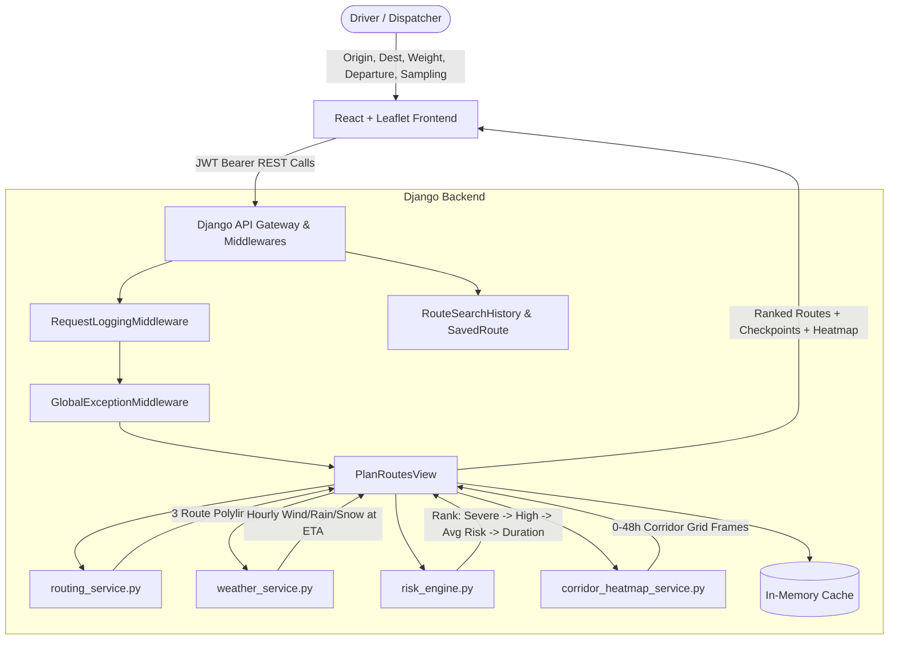

# Spotter — Weather-Aware Truck Routing & Fleet Cockpit

A full-stack freight navigation platform built with **Django REST Framework** and **React + Leaflet** that assists truck drivers and fleet dispatchers in choosing the safest route based on real-time weather forecasts along the route corridor, cargo weight, and travel time.


---

## 🌟 Key Features

1. **Guaranteed 3 Route Alternatives**:
   - Integrates with OSRM (Open Source Routing Machine) to retrieve and evaluate 3 distinct highway corridors between any origin and destination.
2. **Dynamic Checkpoint Weather Sampling (10 / 25 / 50 Miles)**:
   - Samples weather every **10, 25, or 50 miles** along each route using the truck's exact estimated arrival time (**ETA**) at each checkpoint ($departure\_time + cumulative\_duration$).
   - Integrates with **Open-Meteo Free Forecast API** (no API key required) for hourly wind speed (mph), precipitation rate (in/hr), snowfall rate (in/hr), and temperature.
3. **Strict Weather & Load Risk Engine**:
   - Evaluates risk thresholds:
     - **Wind (mph)**: Low (`<25`), Moderate (`25–34`), High (`35–44`), Severe (`45–54`), No Travel (`≥55`)
     - **Rain (in/hr)**: Low (`<0.10`), Moderate (`0.10–0.25`), High (`0.25–0.50`), Severe (`0.50–1.00`), No Travel (`>1.00`)
     - **Snow (in/hr)**: Low (`<0.5`), Moderate (`0.5–1.0`), High (`1.0–2.0`), Severe (`2.0–3.0`), No Travel (`>3.0`)
   - **Cargo Load Escalations**:
     - $\ge 55\text{ mph wind} \rightarrow$ **No Travel** for any load.
     - $45\text{–}54\text{ mph wind} + >30,000\text{ lb load} \rightarrow$ **No Travel**.
     - $35\text{–}44\text{ mph wind} + >40,000\text{ lb load} \rightarrow$ **Severe** (escalated from High).
4. **Deterministic Recommendation Hierarchy**:
   Ranks routes according to strict priority order:
   1. **Fewest Severe miles** (and No Travel miles)
   2. **Fewest High miles**
   3. **Lowest average risk**
   4. **Shortest travel times**
5. **Interactive Leaflet Cockpit & Checkpoints**:
   - Polylines color-coded along the route by segment risk level (Green = Low, Amber = Moderate, Orange = High, Crimson = Severe, Maroon = No Travel).
   - Checkpoint markers with interactive popovers showing ETA, wind, rain, snow, temperature, and load escalation alerts.
6. **Corridor Weather Heatmap Layer with 0–48h Forecast Slider**:
   - Visualizes weather storm fronts across the entire trip corridor.
   - Interactive timeline slider: `+0h (Departure)`, `+3h`, `+6h`, `+9h`, `+12h`, `+18h`, `+24h`, `+30h`, `+36h`, `+42h`, `+48h`.
   - **Play/Animate** button that auto-loops through the 48-hour forecast.
   - Metric selector: Hazard Level, Wind Speed, or Precipitation.
7. **Full Authentication & Middleware Suite**:
   - JWT authentication (`djangorestframework-simplejwt`) with auto-refresh interceptors.
   - 1-Click **"Demo Fleet Driver"** login for instant review.
   - Custom `RequestLoggingMiddleware` (attaches `X-Request-ID` and `X-Response-Time-Ms`).
   - Custom `GlobalExceptionMiddleware` returning uniform JSON error responses.
   - Route search history and bookmarked saved trips.

---

## 🏗️ Architecture Overview



---

## 🚀 Getting Started

### Prerequisites
- Python 3.10+
- Node.js 18+ and npm

### 1. Backend Setup
```bash
# Navigate to project root
cd d:/Codes/Spotter

# Activate Python virtual environment
.\venv\Scripts\activate   # Windows
# source venv/bin/activate  # macOS / Linux

# Navigate to backend directory
cd backend

# Apply database migrations
python manage.py migrate

# Run backend test suite (8 tests)
python manage.py test

# Start the Django development server
python manage.py runserver 127.0.0.1:8000
```
Backend API will be running at `http://127.0.0.1:8000/`.

### 2. Frontend Setup
In a new terminal window:
```bash
# Navigate to frontend directory
cd d:/Codes/Spotter/frontend

# Install dependencies
npm install

# Start Vite development server
npm run dev
```
Frontend cockpit will be running at `http://localhost:3000/`.

---

## 📡 API Reference

| Method | Endpoint | Description | Auth Required |
| :--- | :--- | :--- | :--- |
| `GET` | `/api/geocode/?q=...` | Autocomplete search for cities & freight hubs | No |
| `POST` | `/api/routes/plan/` | Calculates 3 routes, weather at ETAs, risks & heatmap | No (tracks user if auth) |
| `POST` | `/api/auth/demo/` | 1-Click login as Demo Fleet Driver | No |
| `POST` | `/api/auth/login/` | Driver login with credentials | No |
| `POST` | `/api/auth/register/` | Driver account registration | No |
| `POST` | `/api/auth/token/refresh/` | Refreshes JWT access token | No |
| `GET` | `/api/auth/profile/` | Retrieves authenticated user profile | Yes |
| `GET` | `/api/routes/history/` | Fetches user's past evaluated trips | Yes |
| `GET` | `/api/routes/saved/` | Fetches user's bookmarked trips | Yes |
| `POST` | `/api/routes/saved/` | Saves / bookmarks a route | Yes |
| `DELETE` | `/api/routes/saved/<id>/` | Deletes a saved bookmark | Yes |

### Example `POST /api/routes/plan/` Request Body:
```json
{
  "origin": {
    "name": "Chicago, Illinois",
    "lat": 41.8781,
    "lon": -87.6298
  },
  "destination": {
    "name": "Denver, Colorado",
    "lat": 39.7392,
    "lon": -104.9903
  },
  "departure_time": "2026-10-25T14:00:00Z",
  "load_weight_lbs": 42000,
  "sampling_interval_miles": 25
}
```

---

## 🧪 Unit & Integration Tests

All risk thresholds, cargo load escalation logic, composite maximum scoring, and route ranking priority rules are covered by Django unit tests.

To run the test suite:
```bash
cd backend
python manage.py test
```

Test Results:
- `test_wind_thresholds_empty_truck`: Validates Low (`<25`), Mod (`25-34`), High (`35-44`), Severe (`45-54`), No Travel (`≥55`).
- `test_load_weight_escalation_rules`: Validates $\ge 55$ mph No Travel, $45-54$ mph $+ >30\text{k}$ lb No Travel, and $35-44$ mph $+ >40\text{k}$ lb Severe.
- `test_rain_thresholds`: Validates $<0.10, 0.10-0.25, 0.25-0.50, 0.50-1.00, >1.00$.
- `test_snow_thresholds`: Validates $<0.5, 0.5-1.0, 1.0-2.0, 2.0-3.0, >3.0$.
- `test_checkpoint_composite_max_risk`: Validates checkpoint risk is max of wind, rain, snow.
- `test_route_recommendation_ranking`: Validates recommendation ranking: Fewest Severe miles $\rightarrow$ Fewest High miles $\rightarrow$ Lowest avg risk $\rightarrow$ Shortest time.
- `test_geocode_endpoint` & `test_demo_auth_login`: Validates API endpoints.

---

## 📖 Architecture & Design Documentation

For in-depth algorithmic specifications, OSRM waypoint detour mathematics, cargo physics escalation matrices, and frontend cartography details, refer to [DESIGN.md](DESIGN.md).
